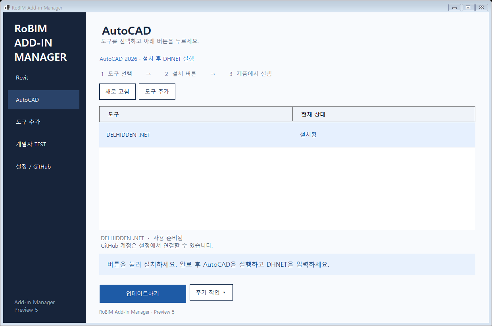
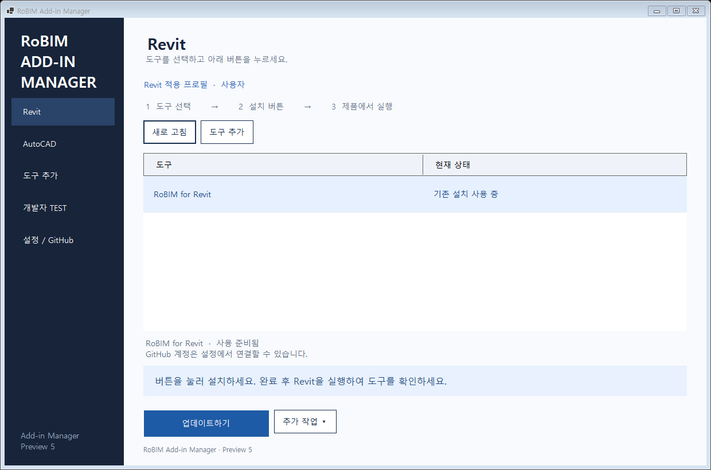

# RoBIM Add-in Manager 간단 사용설명서

**Preview 7 작업본 / 2026-10-15**

## 1. 설치 파일 받기

[RoBIM Add-in Manager 배포 페이지](https://github.com/gagaggan/RoBIM-Add-in-Manager/releases) 또는 검증한 작업본의 `artifacts/RoBIM-Manager-Setup.exe`를 실행합니다. 기존 매니저가 있으면 종료한 뒤 실행하십시오. Preview 7 작업본은 이번 빌드 설치 파일을 사용합니다. 바탕화면/시작 메뉴의 **RoBIM Add-in Manager**를 엽니다.

매니저 설치와 CAD/Revit 도구 설치는 별도입니다. 매니저를 열고 사용할 제품에서 도구를 설치합니다.

설치 후 **Windows 설정 → 앱 → 설치된 앱**에서 `RoBIM Add-in Manager`를 확인할 수 있습니다. 업데이트도 새 Setup.exe를 실행하면 됩니다. 제거는 해당 항목의 **⋯ → 제거**를 사용합니다. 매니저를 제거해도 설치된 Revit·AutoCAD 도구, 사용자 설정, 인증과 백업은 유지합니다.

설치 직후 목록이 갱신되지 않으면 Windows 설정 창을 완전히 종료하고 다시 여십시오. 현재 PC에서는 설정 프로세스를 새로 연 뒤 Preview 6 표시와 제거 메뉴를 직접 확인했습니다.

## 2. AutoCAD 도구 사용

1. 왼쪽 **AutoCAD**를 누릅니다.
2. 목록에서 **RoBIM CAD 연결 모듈**을 선택합니다.
3. 안내대로 AutoCAD를 종료합니다. 종료하면 버튼이 자동으로 켜집니다.
4. **설치하기** 또는 **업데이트하기**를 누르고 확인합니다.
5. AutoCAD를 실행합니다. 처음에는 **RoBIM → 관리 → Reload**만 표시됩니다.
6. Manager에서 **버튼 선택 / 적용 준비**를 누릅니다. 필요한 버튼만 체크하고 버튼 이름·패널·순서를 조정합니다. CAD가 여러 개면 적용할 세션을 선택합니다.
7. **선택 적용 준비**를 누르고, 대상 CAD에서 **RoBIM → 관리 → Reload**를 누릅니다.
8. 선택한 버튼이 등록되고 Manager에 **CAD 적용 완료**가 표시됩니다. 체크를 해제한 버튼은 리본과 직접 명령에서 모두 해제됩니다.

처음 설치하는 CAD 도구는 로그인 없이 동봉 버전을 사용할 수 있습니다. 이미 설치된 도구의 원격 업데이트에는 계정 연결이 필요합니다. 동봉 버전을 따로 선택하려면 **추가 작업 → CAD 동봉 버전 설치**를 사용합니다.

버튼과 기능의 후속 변경은 CAD를 켠 채 준비할 수 있습니다. **추가 작업 → CAD 최신 기능 다운로드 / 적용 준비** 또는 **CAD 패키지 ZIP에서 적용 준비**로 새 패키지를 읽고 버튼을 선택한 뒤 CAD Reload로 적용합니다. 로컬 ZIP은 같은 위치의 `.zip.sha256` 파일이 필요합니다. 준비만으로는 기존 CAD 실행 상태가 바뀌지 않으며 CAD가 응답한 후에 완료로 표시합니다. 연결 모듈 자체가 달라졌으면 CAD 종료 후 전체 업데이트가 필요합니다.

실행 중인 정리·분할 명령과 창을 마친 뒤 Reload하십시오. 다른 세션에 준비했거나 해당 CAD를 재시작했다면 Manager에서 다시 준비합니다. 다음 CAD 실행에서는 마지막 적용 완료 버튼 구성을 복원합니다.

대상은 .NET 10 기반 AutoCAD 2026.1.2 이상입니다. 기존 LISP의 DELHIDDEN 명령과 .NET의 DHNET 명령을 구분하십시오. 삭제 규칙은 [CAD 저장소](https://github.com/gagaggan/RoBIM-CAD#삭제-규칙)를 참고하십시오.

## 3. Revit 도구 사용

1. 왼쪽 **Revit**을 누릅니다.
2. 목록에서 사용할 도구를 선택합니다.
3. 아래 파란 안내를 읽고 **설치하기 / 업데이트하기 / 업데이트 준비** 버튼을 누릅니다.
4. 완료 안내에 따라 Revit을 실행하거나 Revit 안에서 **적용 및 Reload**를 누릅니다.

새 설치와 일반 확장은 Revit 종료가 필요합니다. 기존 RoBIM 도구를 Revit 실행 중 업데이트할 때는 파일을 준비하고 Revit 안에서 적용합니다. Revit 실행 중 첫 준비 시 연결 확장이 없으면 매니저가 설치합니다. 연결 버튼이 아직 없으면 pyRevit 기본 Reload를 한 번 누르십시오.

**Revit의 적용 버튼:** RoBIM TEST → RoBIM 연결 TEST → 적용 및 Reload.

준비를 마치면 매니저 버튼도 **Revit에서 적용하기**로 바뀝니다. 이 버튼은 위치를 안내하며, 실제 적용은 Revit 안에서 실행합니다. DLL 등 재시작이 필요한 변경은 Revit을 종료하고 설치해야 합니다. 첫 설치에는 pyRevit 설치와 Revit 연결이 사전에 필요합니다.

*그림은 화면 확인용 예시이며 실제 설치 상태는 앱에서 확인하십시오.*

## 4. 계정 연결이 필요하다고 나올 때

1. **GitHub 연결하기**를 누르면 **설정 / GitHub** 화면이 열립니다.
2. **GitHub 로그인 / 저장**으로 브라우저 인증을 완료합니다. 이미 저장된 계정은 선택 후 **선택 계정 연결**을 누릅니다.
3. 표시된 연결 ID를 확인하고 Revit 또는 AutoCAD 화면으로 돌아갑니다.
4. 설치 버튼을 다시 누릅니다.

현재 사용자에게 확인된 GitHub ID는 `gagaggan`이고 개발자 ID는 `jm`입니다. 별개의 값입니다. PAT를 사용하려면 설정 화면의 토큰 입력란에 넣고 **토큰 확인 및 저장**을 누릅니다. 토큰은 Windows 자격 증명에 저장하며 Git URL에 넣지 않습니다.

PAT의 대상 저장소와 Metadata/Contents 읽기 권한, 인증 세부 사항은 [패키지·인증 설명](EXTENSION_PACKAGES.md)을 참고하십시오.

## 5. 다른 Git URL 도구를 추가할 때만

1. **도구 추가**를 누릅니다.
2. Git URL을 붙여 넣고 **URL 확인 및 등록**을 누릅니다.
3. **Revit / AutoCAD**로 돌아오면 해당 제품 목록에 도구가 표시됩니다.
4. 도구를 선택하고 설치 버튼을 누릅니다.

계정의 애드인 토픽 저장소는 자동으로 조회합니다. 일반 저장소는 표시하지 않습니다. URL 등록만으로 설치되지는 않습니다. 지원 형식은 pyRevit 확장과 컴파일된 AutoCAD .bundle이며 독립 Revit C# .addin 및 GitHub 외 서버는 현재 제외합니다.

## 6. 개발자만 사용하는 TEST

**개발자 TEST → 브랜치 조회 → 브랜치 선택 → TEST 조회 → 패널 선택 → 설치 또는 Reload용 TEST 준비 → 개발자 프로필 적용** 순서입니다.

GitHub에 아직 올리지 않은 코드는 **로컬 Git 선택**으로 원래 RoBIM-pyrevit 작업 폴더를 선택합니다. 원본은 읽기만 하며 Commit/Push는 원래 Git 저장소에서 진행합니다. 0개 도구인 패널은 선택할 수 없습니다. 첫 사본에 DLL이 포함되면 Revit을 종료하고 설치해야 합니다.

일반 도구로 돌아오려면 **Revit → 추가 작업 → Revit 일반 도구로 돌아가기**를 누릅니다. Revit 실행 중이면 적용 및 Reload를 실행합니다. 프로필 전환은 기존 Git 브랜치를 main으로 바꾸는 기능이 아닙니다.

## 7. 복원과 제거

제품 화면에서 도구 선택 → **추가 작업 → 이전 버전 복원 / 도구 제거**. 해당 제품은 종료해야 합니다. 기존 외부 설치는 제거·자동 복원 대상에서 제외합니다. 백업 복원은 가장 최근의 복원 가능한 백업을 사용합니다.

매니저 자체는 Windows의 설치된 앱에서 제거합니다. 도구·백업·설정은 남으므로 필요하면 도구를 먼저 개별 제거하십시오.

## 8. 막힐 때

CAD 새 패키지에는 **블록 분해 (EXBX)**를 선택 등록할 수 있습니다. 기존 연결 모듈은 유지하고 **추가 작업 → CAD 패키지 ZIP에서 적용 준비**에서 ZIP과 SHA-256을 확인한 뒤 필요한 버튼만 선택하고 CAD Reload를 누릅니다. 분할 기능의 이름 일괄 편집·혼합 축척 표시는 CAD 기능 DLL에 포함되므로 Manager 프로그램을 다시 설치할 필요가 없습니다.

| 표시/상황 | 할 일 |
| --- | --- |
| 제품 종료 후 설치 | 대상 제품을 저장하고 종료한 뒤 돌아옵니다. 버튼이 자동으로 켜집니다. |
| 설치 상태 확인 필요 | 추가 작업에서 설치 위치 확인. 기존 수정 파일과 중복 설치를 정리하기 전 덮어쓰지 않습니다. |
| Revit에서 적용하기 | Revit 안의 적용 및 Reload를 누릅니다. |
| 적용 버튼이 안 보임 | pyRevit 기본 Reload를 한 번 실행합니다. |
| 재시작이 필요한 파일 | Revit 종료 후 일반 설치. 일반 설치가 완료되면 해당 도구의 이전 준비 요청은 정리됩니다. |
| 도구 목록이 비어 있거나 접근 실패 | 설정에서 ID와 권한을 확인하고 제품 화면의 새로 고침을 누릅니다. |
| 기존 Git 개발 사본 | 현재 브랜치를 보존합니다. main으로 강제 변경하거나 원본을 자동 삭제하지 않습니다. |
| 매니저 창이 안 보임 | 시작 메뉴에서 다시 실행하면 기존 창을 복원합니다. |
| Manager는 준비됨인데 CAD는 준비된 변경이 없다고 표시 | Manager를 종료하고 시작 메뉴에서 다시 실행합니다. Codex 같은 패키지 앱에서 직접 실행한 경우 준비 파일이 앱 전용 폴더에 저장될 수 있습니다. 기존 준비 파일은 삭제하지 말고 실제 저장 위치를 확인해 복구합니다. |

작업 기록은 **설정 / GitHub → 작업 기록 보기**에 있습니다. 토큰 원문은 문의 내용에 포함하지 마십시오.

## 9. GitHub 저장 위치

| 내용 | 저장소 |
| --- | --- |
| 매니저 소스·설치 파일·이 설명서 | [RoBIM-Add-in-Manager](https://github.com/gagaggan/RoBIM-Add-in-Manager) |
| CAD 도구 소스·CAD 패키지 | [RoBIM-CAD](https://github.com/gagaggan/RoBIM-CAD) |
| Revit 도구 소스·개발 브랜치 | [RoBIM-pyrevit](https://github.com/gagaggan/RoBIM-pyrevit) |

설명서도 소스와 함께 Git으로 관리합니다. 인증정보·개인 설치 기록·백업은 Git에 올리지 않습니다. 설치나 Reload만으로 Commit/Push되지 않으며 실행 사본은 원본 개발 저장소와 분리됩니다.

실제 Revit 리본·모델 내 Reload 동작과 유효 PAT 신규 입력은 사용자 환경에서 확인해야 합니다. [검증 기록](MANAGER_VALIDATION.md)을 참고하십시오.
