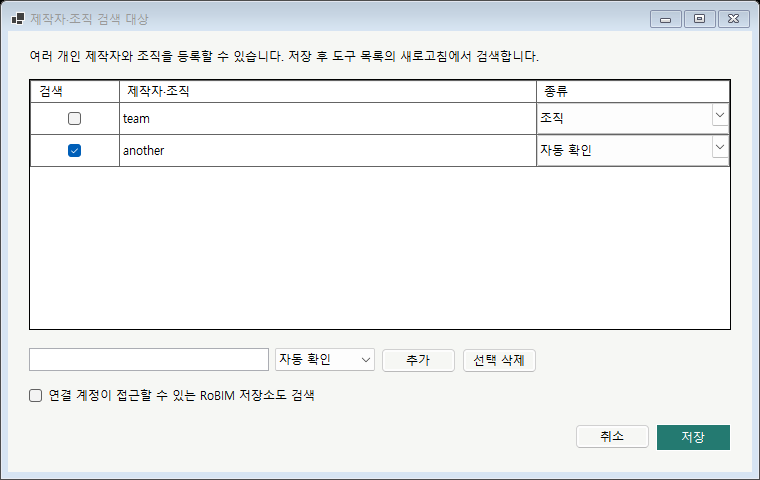

# RoBIM Add-in Manager 사용설명서

필요한 도구를 설치하고 리본을 구성하는 방법을 설명합니다. Git·C#·개발 SDK를 설치할 필요는 없습니다. 이 설명서는 2026-10-22 Preview 32 기준이며 배포 버전에 따라 메뉴와 제공 기능이 다를 수 있습니다.

## 처음 실행하기

1. [배포 페이지](https://github.com/RoBIM-tech/RoBIM-Add-in-Manager/releases)에서 관리자가 안내한 버전의 Setup을 받아 설치합니다. Windows 시작 메뉴의 **RoBIM Add-in Manager**로 실행합니다.
2. 사용할 제품이 요구하는 버전을 확인합니다. 현재 독립 Revit 모듈은 Revit 2026.5 이상, CAD 모듈은 AutoCAD 2026.1.2 이상을 대상으로 합니다. Python 도구는 Revit에 연결된 pyRevit이 필요합니다.
3. **Revit / Revit · pyRevit / AutoCAD / Navisworks** 중 사용할 목록을 선택합니다.
4. 카드의 이름·기능 설명과 설치 상태를 확인합니다. 검색으로 도구를 찾을 수 있습니다. 카드 수는 창 너비에 따라 달라집니다.

목록에 카드가 보이는 것은 설치 가능한 기능이 있다는 뜻입니다. 실제 Revit/CAD 리본에는 설치하고 적용한 명령이 표시됩니다.

## 버튼 설치와 제거

1. 필요한 카드의 **설치하기**를 누릅니다. 독립 Revit Add-in은 저장소 하나에 버튼 하나이므로 별도의 기능 목록 확인 없이 다운로드·버전/해시 검사·버튼 설치 준비를 이어서 처리합니다. 처음 사용하는 제품은 필요한 연결 모듈 안내를 완료합니다.
2. 호스트가 실행 중이면 지원되는 변경을 준비합니다. **준비됨** 상태를 확인합니다.
3. Revit은 자동 적용 요청 후 Manager의 **적용 완료**와 실제 버튼을 확인합니다. AutoCAD는 아래 Reload를 실행합니다. 설치한 독립 버튼은 기본 탭·패널에 자동 추가됩니다. 리본 편집에서 따로 추가할 필요가 없으며, 이미 저장한 사용자 위치·이름·묶음은 유지합니다.
4. 필요 없는 버튼은 같은 카드에서 제거합니다. 실행 중인 Revit에는 제거도 자동 적용을 요청하며 AutoCAD는 Reload가 필요합니다.

| 도구 종류 | 적용 방법과 수동 재시도 |
| --- | --- |
| 독립 Revit Add-in | Manager에서 자동 적용 요청. 필요 시 RoBIM 관리 → 독립 Add-in → Reload |
| Revit · pyRevit | 연결이 로드되어 있으면 Manager에서 자동 적용 요청. 필요 시 RoBIM 관리 → Manager → pyRevit Reload |
| AutoCAD | RoBIM → 관리 → Reload |

Manager의 해당 Reload 작업을 사용할 수도 있습니다. 진행 중인 명령과 열린 RoBIM 도구 창을 마치고 적용합니다. 고정 연결 모듈 교체 등으로 종료 안내가 나오면 모델/도면을 저장하고 안내한 호스트를 종료한 뒤 진행합니다.

버튼 제거와 공용 연결 모듈 전체 제거는 다릅니다. 버튼 하나를 제거했다고 다른 버튼의 공용 파일까지 삭제되지는 않습니다.

preview.44부터 Windows 설정 → 설치된 앱 → RoBIM Add-in Manager → 제거에서 Manager가 설치한 도구·Host/Loader·검색 기록·다운로드 캐시·복구 백업을 함께 정리합니다. 이전 버전의 제거 프로그램에는 적용되지 않습니다.

제거 중 **개인 설정 삭제 / 개인 설정 유지 / 취소**를 선택합니다. 유지하면 계정 연결·검색 대상·리본 배치·설치 위치·실행 방식 설정을 남깁니다. 삭제하면 이 설정과 Manager 전용 인증 정보를 정리합니다. 이전 저장소 검색 결과·수동 등록 목록·설치 선택·다운로드 기록은 두 경우 모두 정리합니다. 깨끗한 재설치 시험에는 **개인 설정 삭제**를 선택하십시오.

Revit·AutoCAD·Manager가 실행 중이면 **재시도 / 취소** 창을 표시합니다. 작업을 저장하고 프로그램을 종료한 다음 **재시도**를 누르면 이어서 제거합니다. 강제 종료하거나 실행 상태를 무시하지 않습니다. 외부 도구·다른 제품·pyRevit 본체·GitHub 공용 로그인·개발 저장소·모델 파일은 유지합니다. 관리 도구의 사용자 변경이나 다른 설치의 등록 파일이 확인되면 제거를 중단하고 안내합니다. 정리 실패 시 Manager 실행 파일과 남은 복구 자료를 유지합니다.

## 상태 읽는 방법

| 상태/안내 | 의미 | 다음 작업 |
| --- | --- | --- |
| 설치 안 됨 | 기능이 아직 선택 설치되지 않음 | 필요한 카드 설치 |
| 준비됨/자동 적용 대기 | 변경이 대기 중이며 실제 리본에 반영되기 전 | Revit 명령·도구 창을 마치고 응답 확인. CAD는 Reload |
| 적용 완료 | 해당 호스트가 변경 적용을 확인함 | 버튼 표시와 기능 실행 확인 |
| 재시작 필요 | 현재 실행 중 교체할 수 없는 파일/연결 변경 | 작업 저장 → 호스트 종료 → 설치 적용 |
| 외부 설치 | Manager가 소유권을 확인하지 않은 기존 설치 | 설치 위치와 기존 설치 경로 확인 |
| 로컬 변경 | 설치 뒤 사용자가 파일을 수정한 상태 | 수정 내용을 보존하고 관리자에게 확인 요청 |

외부 설치나 로컬 변경 안내에서 반복 설치하거나 폴더를 임의로 삭제하지 않습니다. 카드의 추가 관리 메뉴에서 설치 폴더와 상세 정보를 확인할 수 있습니다.

## 도구 이름과 설치

카드에는 `파라미터 복사`, `파라미터 일괄 수정`처럼 기능 이름을 표시합니다. 저장소와 패키지의 RoBIM 식별자는 내부 연결과 기존 설치 인식을 위해 유지합니다. 다운로드 전에도 설치할 버튼이 카드에 보이며, `TEST · 설치 시 버전 확인`은 설치 과정에서 배포 버전을 확인한다는 뜻입니다.

독립 버튼의 **··· → 업데이트 확인**은 새 배포본을 확인할 때 사용합니다. 처음 설치하기 위한 선행 단계가 아닙니다.

## 버전·업데이트·복원

### 정식 도구의 TEST 수정본 받기 (Preview 32부터)

독립 Revit 도구 카드의 **··· → 저장소 TEST 버전 설치…**를 선택합니다. Manager가 해당 저장소의 최신 TEST 릴리스 ZIP을 직접 내려받아 SHA-256, 모듈/명령 ID와 TEST 채널을 검사하고 설치를 준비합니다. 파일을 브라우저에서 따로 받을 필요는 없습니다. Revit이 실행 중이면 자동 적용 응답을 확인합니다.

같은 카드의 **··· → 저장소 정식 버전 설치…**로 최신 정식 배포로 돌아갈 수 있습니다. TEST와 정식은 같은 버튼의 코드 버전을 교체하며, 둘을 동시에 실행하는 방식은 아닙니다. 선택한 채널의 배포 파일이 없으면 안내 후 설치를 중단합니다. 정식 저장소의 기본 배포 구분은 유지되며 일반 새로고침으로 TEST가 자동 설치되지는 않습니다. TEST 수정본을 다시 받으려면 동일한 TEST 메뉴를 사용합니다.

카드 우상단의 **···**에서 해당 도구가 제공하는 공용 패키지 관리·업데이트·이전 버전 복원 항목을 확인합니다. 복원은 제공되는 백업/패키지 목록을 기준으로 합니다. 모든 Git 브랜치나 태그를 각 버튼의 독립 설치 버전으로 고를 수 있다는 뜻은 아닙니다.

관리자가 전달한 새 기능 ZIP을 사용할 때에는 해당 패키지 등록/가져오기 흐름을 사용하고 해시 검사를 완료합니다. 같은 패키지를 공유하는 버튼은 코드 버전도 함께 바뀔 수 있습니다. 어떤 버전으로 돌아가야 할지 불명확하면 현재 버전과 오류를 기록한 뒤 복원합니다.

## Revit 리본 편집

1. 왼쪽 **리본 편집**을 엽니다. 상단에서 수정할 탭을 선택합니다.
2. **＋**로 탭을, **＋ 패널**로 패널을 추가합니다.
3. 버튼·패널 이름을 클릭해 바꿉니다. 탭은 선택한 뒤 이름을 다시 클릭합니다. Enter로 확정하고 Esc로 취소합니다.
4. 버튼을 드래그해 옮깁니다. 앞/뒤 또는 묶음 안의 위/아래 삽입선을 보고 놓습니다. 다른 탭으로 옮길 때에는 드래그한 채 탭 위에 잠시 머뭅니다.
5. 큰 버튼은 한 칸을 사용합니다. 작은 버튼은 **2단 또는 3단 묶음**으로 한 칸에 넣습니다. 묶음의 왼쪽 여백을 드래그하면 묶음 전체가 이동합니다.
6. 세로 구분선을 넣어 도구 구역을 나눌 수 있습니다.
7. **저장**한 뒤 **Revit 적용**을 누릅니다. 준비된 Revit 변경도 자동 요청하므로 별도 Reload 클릭은 필요하지 않습니다. 저장만으로 실행 중 리본이 적용된 것은 아닙니다.

미설치 도구를 배치하는 것만으로 설치되지는 않습니다. 표시 이름을 바꾸어도 기능 자체는 바뀌지 않습니다. 위의 기본 Reload 위치는 사용자 배치에 따라 달라질 수 있습니다.

## pyRevit 설치 위치 바꾸기

1. Revit 작업을 저장하고 종료합니다.
2. **설치 위치 → 폴더 선택**에서 확장들을 둘 상위 폴더를 선택합니다. 개별 `.extension` 폴더를 선택하지 않습니다.
3. **이 위치로 이전 / 적용**을 실행합니다. Manager 관리 설치를 백업·검증한 뒤 옮기고 pyRevit 검색 경로에 등록합니다.
4. Revit을 다시 실행해 선택한 버튼을 확인합니다.

기존의 다른 확장 검색 경로는 보존됩니다. Manager 전용 연결 확장은 기본 검색 위치에 남을 수 있습니다. 설치 위치에 같은 이름의 외부 확장이 있으면 자동 덮어쓰기하지 않습니다.

## 문제 해결

| 증상 | 확인 순서 |
| --- | --- |
| 설치했는데 버튼이 없음 | 자동 적용 대기인지 확인 → 진행 중 명령/창 종료 → 적용 결과와 배치 확인 → 필요 시 수동 Reload |
| 설치하지 않은 버튼도 모두 보임 | 별도의 전체 개발 확장이 활성화되어 있는지 설치 위치·pyRevit 검색 경로 확인 |
| 제거가 비활성/실패 | 진행 작업, 외부 설치, 로컬 변경, 고정 모듈 종료 안내 확인 |
| Native Host DLL이 없다는 오류 | 오류에 표시된 경로와 설치 위치를 기록 → Manager를 Windows 시작 메뉴에서 실행 → 관리자에게 등록/DLL 경로 복구 요청 |
| LocalCache/실제 경로 오류 | Manager를 정상 종료하고 Windows 시작 메뉴에서 다시 실행. 기존 데이터 폴더를 임의로 삭제하지 않음 |
| Reload 후 오류 | 오류 메시지·도구 버전·호스트 버전·누른 순서 기록. 준비/적용 상태를 확인하고 제공되는 복원 사용 |

기능 자체의 조작은 [pyRevit](https://github.com/RoBIM-tech/RoBIM-pyrevit/blob/main/docs/user/README.md), [시트 생성](https://github.com/RoBIM-tech/RoBIM-Revit-Sheets/blob/main/docs/user/README.md), [CAD](https://github.com/RoBIM-tech/RoBIM-CAD/blob/main/docs/user/README.md) 설명서를 사용합니다.

[문서 목록](../README.md) · [개발자 설명서](../developer/README.md)

## TEST 도구와 실사용 구분

왼쪽 **TEST 도구**는 검증 중인 독립 기능의 별도 도구모음입니다. 일반 Revit·AutoCAD·전체 목록에서는 배포 구분이 TEST인 도구를 제외합니다. 정식 배포로 승격된 도구는 일반 목록에 표시되며, 현재 설치된 이전 TEST 버전은 카드에 따로 표시합니다. 정식 Release 게시만으로 기존 PC의 파일을 자동 교체하지 않습니다. 내 도구에는 관리·제거를 위해 설치/준비한 TEST도 표시합니다. 카드에는 배포 구분과 버전이 표시되고 ··· → 기능 설명에서 검증 선언과 선택 버전을 볼 수 있습니다.

- TEST: 개발·검증 중인 버전입니다. TEST 목록에서 명시적으로 선택하여 설치합니다.
- 실사용: 검증자·호스트 빌드·검증 기록을 포함한 배포 선언이 있는 버전입니다.
- 미확인: 구형 패키지 등에 구분 정보가 없습니다. 설치가 되어 있어도 자동으로 실사용이 되지 않습니다.

설치됨·준비됨·Reload 필요는 배포 구분과 별도입니다. TEST 설치도 최초 고정 Host가 없다면 호스트 종료가 필요하고, CAD 변경은 AutoCAD 안의 Reload로 적용합니다. 기존 ‘개발자 TEST’는 기존 pyRevit 유지보수 화면이며 신규 독립 TEST 도구와 구분합니다.

## 독립 Reload·Manager가 회색으로 비활성화될 때

Preview 26 연결은 pyRevit Reload가 같은 탭의 독립 버튼·부모 패널을 비활성화한 뒤, 설치된 버튼의 표시와 활성 상태를 함께 복원합니다. 업데이트된 연결을 적용하고 pyRevit Reload를 마치면 독립 Reload와 Add-in Manager를 다시 사용할 수 있습니다. Revit의 다른 명령 실행 중에는 해당 명령을 마쳐야 합니다.

독립 기능 업데이트는 Manager의 적용/Reload 요청으로 Revit이 대기 시점에 처리할 수도 있고, Revit 상단의 독립 Reload로 직접 적용할 수도 있습니다. 저장소 변경을 상시 감시해 자동 업데이트하지는 않습니다.

## TEST에서 정식 배포로 승격할 때

도구의 배포 구분과 PC에 설치된 버전은 별도입니다. 정식 배포 정보로 갱신하면 일반 Revit 목록에 표시하되, 이전 TEST가 설치되어 있으면 그 버전과 정식 업데이트 안내를 함께 표시합니다. 카드의 업데이트 확인은 저장소의 최신 표시 정보를 다시 확인하고 채널에 맞는 검증된 패키지를 받습니다. TEST 캐시를 정식으로 재표시하거나 설치된 채널을 자동 교체하지 않습니다. 업데이트를 선택하고 자동 적용 응답 뒤 정식 버전 적용을 확인합니다. 제거는 원격 조회와 채널 일치에 종속시키지 않습니다.

## 새로고침과 업데이트 표시

카드의 새로 고침은 로컬 설치 상태와 원격 기본 브랜치의 배포 정보·채널별 최신 버전을 확인합니다. 기존의 연녹색은 설치/선택됨, 회색은 미설치, 연주황색은 업데이트 가능을 나타냅니다. 정식 버전이 설치되어 있고 더 새로운 TEST가 제공될 때만 연보라색 카드와 TEST 보기 링크를 표시합니다. 정식 업데이트가 함께 있으면 연주황색을 우선하며, 미설치 도구나 TEST 설치 자체에 새 색상을 적용하지 않습니다. 업데이트가 있으면 버튼이 업데이트로 바뀌고 설치 버전 → 제공 버전을 표시합니다. 업데이트 먼저 정렬도 제공합니다. 업데이트를 누르면 검증된 패키지를 준비하고 실행 중인 Revit에 자동 적용을 요청합니다. CAD는 AutoCAD Reload를 사용합니다. 새로고침 자체는 패키지 다운로드·설치·모델 변경을 하지 않습니다.

시작·탭 전환·로컬 타이머는 네트워크를 조회하지 않습니다. 저장소 조회 실패 시 기존 설치와 마지막 확인 결과를 유지하고 최신 확인 실패를 표시합니다. 비교할 수 없는 외부/동봉 버전은 임의로 업데이트라고 판정하지 않습니다. Native는 실제 선택 모듈 버전, 기존 pyRevit은 선택 스냅샷의 브랜치·commit, CAD는 기록된 배포 버전을 비교합니다. 정식 설치를 TEST로 자동 전환하거나 새 버전을 자동 설치하지 않습니다.

Manager의 Revit 설치·업데이트·제거 및 리본 편집의 Revit 적용은 별도 Reload 클릭 없이 자동 적용을 요청합니다. Native Host는 세션 ID를 확인해 Idling에서 처리하고, 기존 pyRevit은 연결 확장의 ExternalEvent에서 적용·Reload합니다. 실행 중인 명령·모달 창이 끝나면 처리하며, 최초 Host 설치나 고정 로더/pyRevit 바이너리 교체는 기존 재시작 조건을 유지합니다. 요청 전송과 실제 applied 응답을 구분하고 다른 버튼의 캐시 업데이트는 자동으로 끌어오지 않습니다. 수동 Reload는 재시도용입니다.

## 정식 도구의 새 TEST 버전

새로 고침은 독립 Revit 도구의 정식 Release와 prerelease TEST를 한 번의 배포 목록 조회로 함께 확인합니다. 기본 배포가 정식인 저장소에도 더 높은 버전의 TEST가 있으면 정식 카드에 TEST 버전과 **TEST 보기** 링크를 표시하고 TEST 도구 목록에서도 같은 도구를 제공합니다. 기본 등록과 기존 정식 설치는 그대로 유지합니다. 이미 정식 버전에 포함된 오래된 TEST는 새 알림에서 제외하며, 설치된 TEST는 관리·제거를 위해 목록에 남습니다.

TEST 도구에서 **TEST 설치**를 누르고 확인하면 같은 버튼의 현재 버전을 TEST로 교체하고 Revit에 자동 적용을 요청합니다. 두 버전을 동시에 리본에 설치하는 기능은 아닙니다. 새 정식이 제공되면 **정식 업데이트**, 이전 정식으로 되돌릴 때는 ···의 저장소 정식 버전 설치를 사용합니다. TEST 자체의 업데이트는 내 도구와 TEST 목록에서 표시합니다. 새로고침이나 링크 클릭만으로 설치·선택·리본을 바꾸지 않습니다.

실패한 TEST 조회는 마지막 확인 결과와 실패 안내를 유지하며, 정상 조회에서 TEST가 없어지거나 정식 승격으로 이전 TEST가 포함되면 새 TEST 알림을 제거합니다. TEST의 검증 오류는 정상 정식 배포 조회를 막지 않습니다. 시작·탭 이동·타이머는 로컬 캐시만 읽습니다. 배포자는 정식 기본 channel을 유지하면서 새 TEST tag의 GitHub prerelease와 TEST manifest/ZIP을 게시할 수 있습니다.

## 내 도구의 정식·TEST·업데이트 상태

내 도구와 설치된 카드의 분류·버전은 저장소 기본 채널이 아니라 실제 선택한 모듈의 검증된 채널·버전을 사용합니다. 적용 준비 중이면 그 상태도 표시합니다.

| 실제 설치 | 제공 버전 | 표시와 기본 작업 |
| --- | --- | --- |
| 정식, 최신 | 같은 정식 | 정식 설치 · 제거 |
| 정식 | 더 새 TEST만 제공 | 정식 설치 + TEST 보기 · 연보라 안내, 자동 전환 없음 |
| TEST, 최신 | 기존 정식은 더 낮음 | TEST 설치 · 제거, 업데이트로 표시하지 않음 |
| TEST | 더 새 TEST | TEST 업데이트 · 설치 버전 → 제공 버전 |
| TEST | 설치 버전보다 새 정식/동일 본버전의 정식 승격 | 정식 업데이트 · 해당 정식 패키지 설치 |
| 정식 | 더 새 정식 | 업데이트 · 해당 정식 패키지 설치 |

정식에서 TEST를 선택 설치하면 같은 명령 ID의 설치 채널이 TEST로 바뀌며 내 도구와 TEST 목록에 반영됩니다. 정식 승격을 설치하면 다시 정식으로 표시합니다. 낮은 기존 정식으로 되돌리려면 ···의 저장소 정식 버전 설치를 명시적으로 선택합니다. 기본 업데이트 동작은 버전을 낮추지 않습니다. 새로고침 자체는 설치/채널/리본을 변경하지 않습니다.

## 제작자·조직 검색 대상 (Preview 37+)

도구 목록 상단의 제작자·조직을 누릅니다. 개인 계정/조직 이름 또는 GitHub 소유자 주소를 입력하고 자동 확인·개인·조직 중 하나를 선택해 추가합니다. 여러 대상을 저장하고 검색 체크로 일시 중지할 수 있습니다. 연결 계정이 접근 가능한 RoBIM 저장소 검색도 선택할 수 있습니다.

저장 후 새로고침하면 robim-addon 토픽과 올바른 표시 정보가 있는 새 저장소가 카드로 추가되고 TEST/정식 업데이트도 확인합니다. 새로고침은 자동 설치하지 않습니다. 검색 대상을 제거하거나 권한 조회가 실패해도 기존 목록·설치·리본을 지우지 않습니다. 저장된 목록은 다음 실행에서도 사용하며 시작/탭 이동에는 원격 조회를 하지 않습니다. 비공개 저장소는 연결 계정의 접근 권한이 필요합니다.

## 관리 리본 편집

리본 편집에서 설치한 기능과 함께 pyRevit Reload, 독립 Add-in Reload, Add-in Manager를 배치합니다. 관리 패널 이름·탭·버튼 위치·표시 이름·2단/3단 묶음도 일반 버튼처럼 수정하고 저장한 뒤 Revit 적용을 누릅니다. 기존 관리 버튼 배치는 보존하며 새로 포함된 관리 버튼만 기본 위치에 보완합니다. 해당 종류의 기능이 하나도 설치되지 않으면 관리 버튼만으로 빈 탭을 만들지 않습니다. 관리 버튼의 배치 삭제는 연결 모듈 제거가 아니며, 미배치 상태에서는 기본 위치로 표시됩니다.

기본 패널이 비어 있는 기능은 RoBIM 도구 → 도구에 배치합니다. 관리 탭을 빈 패널의 대체 위치로 사용하지 않습니다. 기능 패키지가 관리 탭/관리 패널을 기본값으로 제시해도 자동 배치에서는 도구 영역으로 분리하며, 사용자가 명시적으로 저장한 배치를 우선합니다. 명시적으로 저장한 사용자 위치는 자동으로 옮기지 않습니다. Native 패키지는 유효한 기본 tab/panel을 선언해야 하며 제작 단계부터 기능 패널을 지정합니다.

Manager 선택 설치는 선택하지 않은 pyRevit 명령과 탭·패널·버튼 묶음 폴더를 활성 확장에서 실제로 제거합니다. sentinel layout만으로 숨기는 방식에 의존하지 않습니다. 선택한 버튼의 부모 컨테이너와 공용 lib는 보존하며 전체 원본은 검증된 별도 캐시에 남겨 재설치합니다. 선택 0개라면 활성 .tab 폴더도 남기지 않습니다. 기존 설치 정리는 선택/보류 상태와 소유권·해시를 확인하고 백업 후 적용합니다. 이미 생성된 Revit 리본 컨트롤은 Reload/다음 시작에서 정리되며 파일 제거와 현재 세션 UI 제거를 구분합니다.

### 리본 연결 오류가 반복될 때 (Preview 38+)

연결 업데이트는 Revit 한 개를 실행한 상태에서 스크립트 변경을 검증·백업한 뒤 표준 pyRevit Reload를 자동 요청합니다. 준비된 다른 버튼 선택이 있으면 먼저 적용해야 합니다. DLL 교체는 기존 재시작 조건을 유지합니다. 선택한 묶음 버튼을 찾지 못하면 오류를 매초 반복하지 않고 제한된 횟수 후 재시도를 멈춥니다. 리본 편집의 Revit 적용 또는 표준 pyRevit Reload로 다시 요청할 수 있습니다. 계속 실패하면 마지막 오류와 누락 버튼의 연결 진단을 확인합니다.

Preview 40에서는 선택된 기존 pyRevit 묶음 버튼이 생성되지 않은 경우 현재 로드된 명령으로 리본 버튼을 복구합니다. Relink Paths 연결과 적용 결과를 실제 Revit에서 확인했습니다. 이전에 출력된 오류창 내용은 기록이므로 닫아도 됩니다. 새 적용이 성공하면 마지막 오류 상태도 해제됩니다.

## pyRevit 제거 후 예전 버튼 잔상

Reload 연결 1.0.0-preview.41은 파일이 제거된 RoBIM pyRevit 버튼이 독립 Add-in과 같은 패널에 남는 경우를 처리합니다. 선택되지 않은 예전 제어는 원래 내부 ID로 식별해 현재 세션에서 비활성·숨김 처리합니다. 파일 제거를 숨김으로 대신하지 않으며 선택된 pyRevit·독립 Add-in·다른 제품의 버튼은 유지합니다. RetiredPythonControls와 BridgeRevision=retirement-1을 적용 기록에 남깁니다. 연결 스크립트만 변경되므로 기존 백업·해시·세션 검증을 통과하면 Revit 실행 중 연결 업데이트와 표준 pyRevit Reload를 사용합니다. 실제 적용 완료는 새 세션 일치 응답과 기록을 확인합니다.

## RoBIM pyRevit 사용 종료

RoBIM은 독립 Native 버튼으로 운영합니다. 기존 기능과 Python 리본 연결은 [Native 전환 절차](https://github.com/RoBIM-tech/RoBIM-Workspace/blob/main/docs/developer/PYREVIT_RETIREMENT.md)에 따라 백업·검증 후 제거합니다. NativeOnly에서는 Host가 리본/Reload를 담당하며 pyRevit 본체·다른 확장은 유지합니다. 고정 Host 교체는 Revit 종료가 필요합니다. 새 PC 적용·재시작 후 검증 전에는 완료로 기록하지 않습니다.

## NativeOnly 연결 호환성 — Manager 1.0.0-preview.43

동봉 Native Host는 1.0.0-preview.4입니다. preview.3에서 발견한 UI JSON 키 대소문자 문제를 수정한 Host부터 RoBIM pyRevit 제거의 필수 조건을 충족합니다. 기존 Manager UI 연결 계약은 유지합니다. 종료 후 정상 Setup 설치와 재시작 세션의 실제 applied 응답을 별도로 검증합니다. 이전 TEST 배포 파일은 교체하지 않습니다.

2026-10-27 실제 PC 적용: 정상 Windows Setup으로 Manager 1.0.0-preview.43 및 Host 1.0.0-preview.4를 설치했습니다. Revit 재시작 후 Native Provider, 독립 기능 8개·관리 버튼 2개를 확인했습니다. Manager.Core의 RequestRevit(false)가 생성한 요청 ID와 Host의 applied 응답이 일치했고, 응답 시각이 안정적으로 유지되어 반복 적용이 없음을 확인했습니다. RoBIM Python 확장 0개·다른 확장 9개 및 기존 Native 선택을 보존했습니다. 모델을 열거나 모델 명령을 실행하는 검증은 수행하지 않았으며 TEST 배포입니다. 기본 브랜치 병합은 수행하지 않았습니다.

## GitHub 로그인과 자동 시작

GitHub 로그인 후 RoBIM-tech 조직의 robim 팀 소속을 확인합니다. 초대만 받은 상태라면 먼저 초대를 수락하십시오. 로그인/팀 확인 전에는 Manager 기능과 새 Host/Loader의 도구 버튼이 잠깁니다. 설정에서 자동 로그인과 Windows 로그인 시 자동 시작을 선택합니다. 첫 로그인은 브라우저에서 진행하고 다음 실행은 저장된 인증을 사용합니다. 창 닫기는 알림 영역으로 숨기며, 알림 영역 메뉴의 종료/로그아웃은 도구 사용을 잠급니다. 인터넷 연결·조직 접근 권한을 확인할 수 없으면 잠깁니다. 기존 Host/Loader는 업데이트 후 Revit·AutoCAD를 재시작해야 적용됩니다. 다른 제품의 버튼은 제한하지 않습니다.

## 로그인 첫 화면과 Reload — preview.46

처음 실행하면 GitHub 로그인 전용 화면이 나옵니다. GitHub로 로그인 또는 저장된 계정으로 로그인을 선택하십시오. 자동 로그인에 성공하면 도구 화면으로 바로 들어갑니다. 로그인하지 않아도 Revit/CAD의 Reload와 Manager 열기는 사용할 수 있습니다. 로그인한 다음 Reload로 준비된 도구와 리본을 다시 적용할 수 있습니다. 실제 기능 실행은 팀 인증 후에만 가능합니다. 이 정책은 이전 preview.45의 Reload 잠금을 대체합니다.

## 계정 설정 (preview.48)

설정 / GitHub에는 현재 연결 계정, 자동 로그인, Windows 로그인 시 자동 시작, 계정 변경과 로그아웃이 표시됩니다. 계정 변경을 누르면 저장 계정 선택과 다른 GitHub 계정으로 로그인할 수 있습니다. 연결 확인은 자동으로 수행하므로 별도의 저장된 연결 확인 버튼은 제공하지 않습니다.

고급 설정은 브라우저 로그인 대신 PAT를 사용하거나 작업 기록을 볼 때만 펼칩니다. 고급 설정을 닫으면 입력 중인 토큰을 지웁니다. Native 전용 전환이 끝난 PC에서는 기존 pyRevit 연결 관리 버튼을 숨깁니다.

## 팀별 정식·TEST 권한 — 2026-10-28

Manager 1.0.0-preview.49 / Revit Host 1.0.0-preview.7 / CAD Loader 1.0.1-test.3 / RoBIM.Access.Core [0.1.0-test.4]부터 적용합니다. 이전의 robim 단일 팀 정책보다 이 정책이 우선합니다.

| GitHub 팀 | Manager와 지원 호스트에서 허용하는 도구 |
| --- | --- |
| RoBIM-tech/robim | 정식(stable) |
| RoBIM-tech/robim-test | 정식 + TEST |
| RoBIM-tech/robim-dev | 정식 + TEST; 저장소 쓰기 권한은 개별 저장소에서 별도로 부여 |
| RoBIM-tech/robim-admin | 정식 + TEST; 관리자 구성원은 gagaggan |

네 팀 중 활성 멤버십 하나가 있어야 사용합니다. 여러 팀 소속이면 admin → dev → test → 일반 사용자 순으로 표시합니다. 상위 역할은 robim 팀의 중복 가입을 요구하지 않습니다. GitHub 초대 수락 전의 pending 상태는 허용하지 않습니다. 저장소 Admin 권한과 앱의 팀 역할은 별개입니다.

일반 사용자는 TEST 메뉴·권유·설치·다운로드·실행을 사용할 수 없습니다. 같은 도구의 검증된 정식 Release가 있으면 정식 버전을 제시합니다. 기존 TEST 설치의 제거는 허용하며 TEST 캐시를 정식으로 재표시하지 않습니다. 알 수 없는 배포 구분은 관리자도 실행하지 못합니다. 패키지 내부의 실제 모듈별 배포 정보를 확인하며 카드 문구만으로 허용하지 않습니다.

Manager는 시작/2분 주기 GitHub 멤버십 조회, 최대 3분 유효 상태를 유지합니다. TEST 팀 조회 실패는 TEST를 허용하지 않지만 별도로 확인한 robim 정식 권한은 유지합니다. 로그아웃·종료·권한 만료는 실행을 잠급니다. 현재 사용자 전용 Named Pipe v2는 stable/test 비트만 전달하고 토큰을 호스트에 넘기지 않습니다. Host/Loader는 1초마다 조회하고 3초 만료 및 명령 실행 직전 재검사를 적용합니다. 구형 v1 호스트는 새 Manager에서 권한을 받을 수 없으므로 세 제품을 함께 업데이트하고 Revit/CAD를 재시작해야 합니다.

로그인 전 첫 화면과 자동 로그인/시작 정책은 유지합니다. 로그인 전에도 정확한 Reload와 Manager 열기 명령은 사용할 수 있습니다. 실제 기능 명령에는 이 예외를 적용하지 않습니다. 사용자 리본·도구 선택·기존 설치 ID는 유지합니다.

이는 Manager와 정식 Host/Loader가 적용하는 권한입니다. GitHub는 같은 저장소의 Release별 다운로드 권한을 나누지 않으므로 저장소 Read 구성원은 GitHub에서 직접 TEST 파일을 받을 수 있습니다. 중계 서버는 도입하지 않았으며 변조된 실행 파일이나 직접 로드까지 통제한다고 설명하지 않습니다.

검증: Manager 엔진 233개, 정상 Windows 역할 UI 19개·계정 UI 6개·Named Pipe 14개가 통과했습니다. SDK 빌드와 실제 Revit/CAD 모델 명령 검증은 구분합니다. 실제 일반 사용자 계정 및 모델/DWG에서의 실행 검증은 미수행입니다. 기본 브랜치 병합과 정식 승격은 별도입니다.

## 자동 결합 모델리스 TEST 전달 · Manager 1.0.0-preview.50

Revit Host 1.0.0-preview.8을 동봉해 자동 결합 0.1.0-test.2의 모델리스 창과 행 선택을 지원합니다. Manager 기능 로직·권한/로그인·CAD 패키지·사용자 선택/리본은 변경하지 않습니다. Host 교체에는 Revit 종료·재시작이 필요합니다. 새 Manager 설치 후 자동 결합 카드를 새로고침하고 TEST 업데이트를 설치합니다. 창에서 뷰를 바꾸거나 모델을 수정해도 결과표를 유지합니다.

로컬 빌드/임시 설치 검증과 실제 PC 설치·Revit 모델 명령 검증은 구분합니다. 배포 근거는 docs/developer/MODELESS_TEST_DELIVERY_20261028.md에 기록합니다.

## preview.51 · Git 없는 로그인과 .NET 확인

GitHub로 로그인을 누르면 인증 코드와 GitHub 인증 페이지가 표시됩니다. 코드 입력·앱 승인 후 연결 계정을 직접 확인하고 Windows 자격 증명 관리자에 Manager 전용 인증을 저장합니다. Git/GCM 설치는 필요하지 않습니다. 기존 Git/GCM 연결 계정은 한 번 다시 로그인해야 합니다. 만료·철회된 인증은 재로그인하며 자동 시작은 브라우저를 열지 않습니다. 계정 목록도 Manager 전용 저장소에서 읽고 공용 GitHub 인증은 변경하지 않습니다. 이전 Git 작업 사본을 관리하는 고급 레거시 기능은 여전히 Git을 필요로 합니다.

Setup은 설치 전에 .NET 실행 환경을 자동 검사합니다. 별도 확인 버튼을 두지 않습니다. Manager는 .NET을 포함해 배포하므로 별도 .NET 설치가 필요 없습니다. Revit 2026.5+/AutoCAD 2026.1.2+의 runtimeconfig와 x64 .NET/Windows Desktop/호스트가 요구하는 ASP.NET Core 실행 환경을 검사합니다. 다른 .NET 버전이나 x86 설치만으로 충족 처리하지 않습니다. 기능 설치 전에도 해당 호스트의 실행 환경을 확인합니다. 등록된 설치 경로와 C:\Revit 2026 같은 별도 경로를 지원하고 찾지 못하면 설치 폴더를 지정합니다. 호스트가 .NET 8인 경우와 .NET 10 x64 런타임 누락을 구분하여 안내합니다. SDK는 사용자 설치 요건이 아닙니다.

정식 전환 대상은 시트 생성·파라미터 복사·중앙파일 복제/워크셋 수정·링크 경로 변경·뷰 복제 및 CAD 전체입니다. 사용자 gagaggan은 최신 TEST 실사용을 Revit 26.5.0.55/AutoCAD R25.1.179.0에서 검증했다고 확인했습니다. 배포/Manager 새로고침/설치/실제 호스트 적용은 각각 확인합니다.

preview.51은 Setup 설치본의 Manager 자체 자동 업데이트를 제공합니다. 로그인 후 6시간 간격으로 Manager Release만 확인하고 새 버전의 고정 Setup asset을 GitHub SHA-256 digest로 검사합니다. 정식 Manager는 TEST로 자동 전환하지 않으며 현재 preview 계열은 후속 preview와 정식 승격을 받을 수 있습니다. 설정에서 자동 업데이트를 끌 수 있습니다. 도구 선택/기능 버전은 자동 변경하지 않습니다. 작업 중이거나 Revit·AutoCAD가 실행 중이면 적용을 대기하며 종료 후 설치 프로그램으로 교체·재시작합니다. Portable은 자동 덮어쓰지 않습니다. 설치 로그와 업데이트 결과는 Manager 데이터의 ManagerUpdates 하위에 기록합니다.

Navisworks 메뉴는 등록 도구가 없는 빈 목록과 기본 경로 설치 버전을 제공합니다. Navisworks 플러그인 패키지 설치·실행 지원을 완료한 것은 아닙니다. .NET 8 호스트 지원은 이번 범위에서 제외합니다.

preview.52: 도구 메뉴와 페이지 제목의 Revit 독립 Add-in을 Revit으로 표시합니다. 내부 모듈·명령·설치 ID와 동작은 유지합니다.

프로그램별 리본 편집: 왼쪽 Revit·AutoCAD·Navisworks 아래에 각각 리본 편집을 둡니다. Revit은 기존 탭/패널/묶음 편집과 자동 적용을, AutoCAD는 기존 CAD 구성의 버튼 이름/패널/순서와 CAD Reload 준비를 사용합니다. CAD 구성을 Revit 리본 파일에 저장하거나 Revit 적용을 호출하지 않습니다. Navisworks는 등록 도구가 없어 편집할 버튼이 없음을 표시합니다. Navisworks 저장·호스트 적용을 지원한다고 표시하지 않습니다.

설정의 Manager 업데이트 확인은 현재/최신 버전 정보만 확인합니다. 새 버전이 있으면 Manager 업데이트 버튼을 표시하며 사용자가 선택하면 검증한 Setup을 준비합니다. 자동 업데이트를 꺼도 수동 확인·설치를 사용할 수 있고, Portable은 배포 페이지를 엽니다.

리본 결과 확인은 현재 Revit PID/시작 시각의 요청 ID와 일치한 응답만 적용 완료로 표시합니다. 이전 세션·이전 요청의 applied는 현재 성공으로 표시하지 않습니다. TEST/정식 전환은 같은 native module/command ID의 저장 배치를 보존해야 하며 별도 실제 호스트 적용 확인이 필요합니다.
